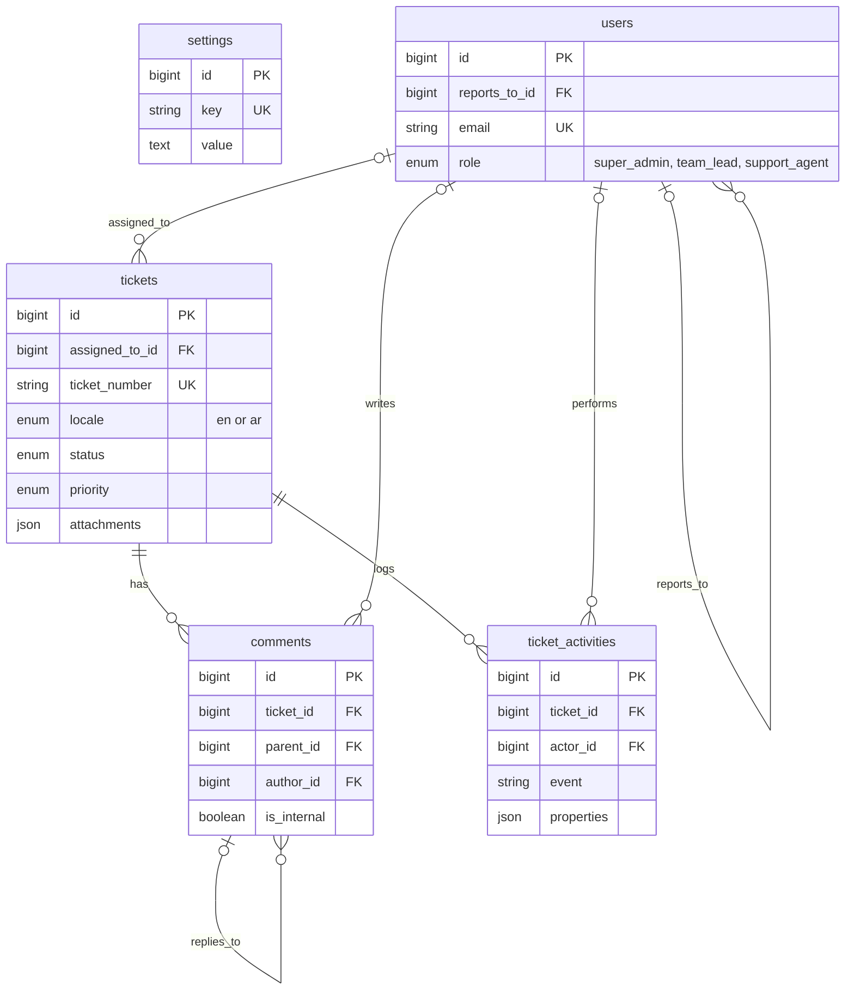

### Project Overview

A centralized, single-tenant **Ticketing & Support** system built with **Laravel** and **Filament**. The first milestone is a complete manual ticketing workflow in the admin panel: intake, triage, assignment, status tracking, and internal and public comments. The production API, the external Project Management System (PMS) bridge, and AI triage are deferred to later phases.

---

### Core Objectives

* **Manual Ticket Intake:** Agents create tickets in Filament from reports received by email, phone, or chat, including the page URL, reporter details, and screenshots stored on the local private disk.
* **PMS Integration Bridge (Deferred, Phase 3):** Convert verified tickets into tasks in an external PMS and synchronize status both ways. Not part of the first milestone.
* **Support Communication:** Agents post public replies (visible to the reporter) and internal notes (visible only to staff). Client API and portal access are deferred.
* **Bilingual Interface (Arabic/English):** The admin panel, client portal, API error messages, and notification emails are available in English (`en`) and Arabic (`ar`). Arabic uses right-to-left (RTL) layout. Users switch language with an EN/عربي switcher, as in adms-gateway.
* **Single-Tenant Scope:** One organization owns all tickets and settings. There are no tenant columns, which keeps the MVP simple.

---

### Key System Capabilities

* **Localization (`en` / `ar`):** Uses only Laravel's built-in translation (`lang/en` and `lang/ar`) and Filament's built-in RTL support. No third-party language packages are added. The language switcher follows the adms-gateway pattern:
  * A `POST /admin/language` route (`admin.language`) validates `locale` as `en` or `ar` (`SetAdminLanguageController`) and stores it in the session under `filament_locale`.
  * A `SetFilamentLocale` middleware reads that session key, falls back to `config('app.locale')` (`APP_LOCALE`), and calls `app()->setLocale()`. It is registered as persistent middleware on the Filament panel.
  * The switcher is a small form with EN and عربي buttons (`filament.partials.language-switcher`). It renders in the panel's `USER_MENU_BEFORE` hook and on the login page.
  * Pages set `lang` and `dir` from the active locale (`dir="rtl"` for `ar`).
  * Reporter locale comes from the `Accept-Language` header, defaulting to `en`. Ticket content is stored as written, so Arabic and English can mix in one ticket.
* **Filament Administration Panel:** Role-based access (`Super Admin`, `Team Lead`, `Support Agent`) stored in a `role` column on `users` for the MVP (Spatie permissions wait for approval), hierarchical reporting (`reports_to`), manual ticket assignment, and manual priority.
* **API Gateway (Deferred, Phase 3):** Sanctum-secured ticket ingestion (`POST /api/v1/tickets`), queued processing, and a raw payload audit log (`webhook_payloads`). Not built in the first milestone.
* **AI Triage (Deferred, Phase 4):** Severity scoring, categorization, duplicate detection, and auto-escalation. Not built in the first milestone.


## 1. Implementation Plan

This phased roadmap starts with a manual ticketing system in Filament. The API, PMS bridge, and AI triage follow in later phases, all built on **Laravel** and **Filament**.

| Phase | Milestone | Key Deliverables |
| --- | --- | --- |
| Phase | Milestone | Key Deliverables |
| --- | --- | --- |
| **Phase 1: Core Ticketing Foundation** | Schema, Filament Base & Localization | • Build migrations for `settings`, `users` (with `role`), `tickets`, `comments`, and `ticket_activities`.<br>• Build `TicketResource` with manual intake: title, description, reporter, page URL, and attachments on the local private disk.<br>• Set up the `en` and `ar` locales with the adms-gateway style switcher and RTL layout. |
| **Phase 2: Agent Workflow & Roles** | Triage, Assignment & Communication | • Add the `role` column (`Super Admin`, `Team Lead`, `Support Agent`) and Filament policies.<br>• Build `UserResource`, the Settings page (general settings), and a ticket stats widget.<br>• Add manual priority, assignment, and status transitions, each writing a `ticket_activities` row.<br>• Add public replies and internal notes (`comments.is_internal`). |
| **Phase 3 (Deferred): Production API & PMS Bridge** | Integration after the MVP | • Install `laravel/sanctum` and `spatie/laravel-permission` (approval required first).<br>• Build `POST /api/v1/tickets` with `Idempotency-Key`, payload limits, `webhook_payloads`, and `SourceAppResource`.<br>• Build `PmsConnectorInterface`, `PushTicketToPmsJob`, `project_syncs`, and the inbound PMS webhook.<br>• Add client endpoints and an optional client portal. |
| **Phase 4 (Deferred): AI Triage** | Intelligent automation | • Add `ai_priority_score` and `ai_analysis`, `AiTriageService`, and duplicate detection.<br>• Add auto-escalation with shadow mode and a kill switch. |


---

### Phase Exit Criteria

* **Phase 1:** Tickets can be created, viewed, and edited in Filament. Switching between English and Arabic works, and Arabic renders RTL.
* **Phase 2:** Agents see only the tickets their role allows (tested). Every status, priority, or assignment change writes a `ticket_activities` row. Internal notes never appear in public replies.
* **Phase 3 (deferred):** `POST /api/v1/tickets` returns `202` within the latency target in Section 5. A repeated `Idempotency-Key` returns the original ticket. A PMS webhook with a stale timestamp is rejected, and a replayed `event_id` does not change state twice.
* **Phase 4 (deferred):** Duplicate detection is active. Shadow-mode agreement between AI and manual priority is reviewed (`AiAccuracyChart`) before auto-escalation is enabled. The kill switch stops auto-push within one job cycle.

---

## 2. Business Flow

### End-to-End Lifecycle

1. **Intake (Agent):** An agent creates a ticket in Filament from a report received by email, phone, or chat. The agent enters the title, description, reporter name and email, page URL, and attachments. Attachments go to the local private disk. The ticket starts as `open` with a `ticket_number` (e.g., `TCK-10042`). Every creation writes a `ticket_activities` row.
2. **Triage (Team Lead or Agent):** A team lead reviews the ticket in Filament, sets the priority, assigns an agent, and moves it to `triaged`.
3. **Work (Agent):** The assigned agent moves the ticket to `in_progress` and posts internal notes for the team. Public replies are written for the reporter. Internal notes never appear in public replies.
4. **Resolution (Agent):** When the work is done, the agent marks the ticket `resolved` and writes a public reply for the reporter. Reopening within 14 days is allowed (proposed).
5. **Closure:** A resolved ticket closes automatically after 14 days (proposed), or earlier when an agent closes it. Team Leads can close spam or duplicates with an internal note.

*Deferred (Phase 3):* PMS escalation and status webhooks. *Deferred (Phase 4):* AI scoring and auto-escalation.

```
open ──► triaged ──► in_progress ──► resolved ──► closed
                                       │
                                       └──► open (reopen within 14 days)
```


---

### Ticket Status Lifecycle

| From | To | Triggered by | Notes |
| --- | --- | --- | --- |
| `open` | `triaged` | Agent / Team Lead | Priority and assignee set |
| `triaged` | `in_progress` | Agent | |
| `in_progress` | `resolved` | Agent | Public reply recommended |
| `resolved` | `open` | Agent | Reopen within 14 days (proposed) |
| `resolved` | `closed` | Agent, or automatically after 14 days (proposed) | |
| Any open state | `closed` | Team Lead (spam or duplicate) | Requires an internal note |

*Deferred (Phase 3):* `pushed_to_pms` status and PMS-driven transitions are added with the PMS bridge.

Every transition writes a `ticket_activities` row. Invalid transitions are rejected with a validation error in Filament.

#### PMS Status Mapping (Deferred, Phase 3)

| PMS status category | Ticket status | Client-visible comment |
| --- | --- | --- |
| Backlog / To do | `pushed_to_pms` | No |
| In progress | `in_progress` | No |
| Done / Completed | `resolved` | Yes: "Engineering marked task as Completed" |
| Cancelled / Won't fix | `closed` | Yes, with an agent note |

Unmapped PMS statuses are stored in `ticket_activities` and leave the ticket unchanged. Mappings are per provider and live in the connector class.

#### Outbound Sync Rules (Deferred, Phase 3)

* Priority and status changes are written to the PMS task as field updates.
* Public comments (`is_internal = false`) are posted to the PMS task. Internal notes are never sent.
* Outbound sync runs as a queued job, never inline in a Filament request.

---

## 3. Database Blueprint, Schema & ERD

### Entity Relationship Diagram (ERD)



### Table Schema Specifications

* **`settings` (Single-Tenant Configuration):** Key/value store for organization-wide settings.
* `id` (bigint, PK), `key` (string, unique; e.g., `retention.days` = `90`, `ticket.auto_close_days` = `14`), `value` (text, nullable), `timestamps`. PMS and AI keys (`pms.provider`, `pms.settings`, `auto_escalate.*`) are added in Phases 3 and 4.


* **`users` (Staff):** Supports hierarchical reporting (`reports_to_id`) and role-based access.
* `id` (bigint, PK), `reports_to_id` (FK -> `users.id`, nullable), `name` (string), `email` (string, unique), `password` (string), `role` (enum: `super_admin`, `team_lead`, `support_agent`; replaced by Spatie roles in Phase 3), `timestamps`, `softDeletes`.


* **`tickets` (Core Issue & Support Records):**
* `id` (bigint, PK), `assigned_to_id` (FK -> `users.id`, nullable), `ticket_number` (string, unique, e.g., `TCK-10042`), `reporter_name` (string, nullable), `reporter_email` (string, nullable, indexed), `locale` (enum: `en`, `ar`, default `en`; chosen by the agent at intake), `title` (string, max 255), `description` (text), `page_url` (text, nullable), `attachments` (json, nullable; paths on the local private disk), `status` (enum: `open`, `triaged`, `in_progress`, `resolved`, `closed`; `pushed_to_pms` is added in Phase 3), `priority` (enum: `low`, `medium`, `high`, `critical`, default `medium`), `timestamps`, `softDeletes`.


**Deferred tables (Phase 3, API and PMS bridge):** Stores scrubbed incoming requests before parsing so failed payloads can be replayed from a Filament action.* `id` (bigint, PK), `ticket_id` (FK -> `tickets.id`, nullable), `source_ip` (string), `source` (enum: `client_api`, `pms_webhook`), `event_id` (string, nullable; unique per source, used for idempotency), `headers` (json; allow-listed headers only), `raw_payload` (json; scrubbed), `processing_status` (enum: `pending`, `processed`, `failed`, `duplicate`), `attempts` (unsignedTinyInteger, default `0`), `error_message` (text, nullable), `timestamps`.


* **`project_syncs` (PMS Task Mapping):** Links each ticket to at most one external task per PMS provider (unique index on `ticket_id` + `pms_provider`), which prevents duplicate task creation.
* `id` (bigint, PK), `ticket_id` (FK -> `tickets.id`), `pms_provider` (string, e.g., `jira`, `clickup`, `linear`, `custom`), `external_task_id` (string, indexed), `external_task_url` (string), `sync_status` (enum: `synced`, `failed`, `out_of_sync`), `last_synced_at` (timestamp), `sync_attempts` (unsignedTinyInteger, default `0`), `last_error` (text, nullable), `timestamps`.


* **`comments` (Threaded Ticket Communication):** Holds internal staff notes and public replies on a ticket.
* `id` (bigint, PK), `ticket_id` (FK -> `tickets.id`), `parent_id` (FK -> `comments.id`, nullable for threaded replies), `author_id` (FK -> `users.id`, nullable; null for system comments), `body` (text), `is_internal` (boolean, default `false`; internal notes are never shown in public replies), `attachments` (json, nullable), `timestamps`.
* **`ticket_activities` (Audit Trail):** Records every status, priority, and assignment change.
* `id` (bigint, PK), `ticket_id` (FK -> `tickets.id`), `actor_id` (FK -> `users.id`, nullable), `event` (string, e.g., `ticket_created`, `status_changed`, `priority_changed`, `assignee_changed`), `properties` (json, nullable), `created_at`.


---

## 4. Technical Documentation

### A. API Specification (Deferred to Phase 3; Sanctum Authenticated)

All external requests must include `Authorization: Bearer <tenant_api_token>` and `Accept: application/json`. Submission requests must also include a unique `Idempotency-Key` header (UUID v4 recommended). Payloads are capped at 5 MB, with at most 5 screenshots of 2 MB each (PNG, JPEG, or WebP).

#### 1. Submit Bug / Support Ticket

* **Endpoint:** `POST /api/v1/tickets`
* **Request Payload:**

```json
{
  "title": "Checkout button unresponsive on Safari",
  "description": "Clicking Pay Now throws a TypeError in console.",
  "priority": "high",
  "page_url": "https://app.example.com/checkout?cart=992",
  "reporter": {
    "name": "Sara Ali",
    "email": "sara@client.com"
  },
  "device_metadata": {
    "browser": "Safari 18.1",
    "os": "macOS 15.1",
    "viewport": "1440x900",
    "console_errors": ["TypeError: undefined is not an object (evaluating 'cart.submit')"]
  },
  "screenshots": [
    "data:image/png;base64,iVBORw0KGgoAAAANSUhEUgAA..."
  ]
}

```

* **Request rules:**
  * `priority` is a hint only. The server sets the final priority during triage (default `medium`).
  * `title` max 255 characters. `description` max 10,000 characters. `reporter.email` must be a valid email.
  * `console_errors` max 50 entries, each truncated to 1,000 characters.
  * Repeating a request with the same `Idempotency-Key` returns `200 OK` with the original response and creates no second ticket. Keys are retained for 24 hours.
* **Response (`202 Accepted`):**

```json
{
  "status": "queued",
  "ticket_number": "TCK-10042",
  "tracking_url": "https://support.yourdomain.com/tickets/TCK-10042"
}

```

#### 2. Client Ticket Status & Comments

* **Get Ticket Details:** `GET /api/v1/tickets/{ticket_number}` requires the `X-Tracking-Token` header (returned once at creation). A missing or mismatched token returns `404`, not `403`, so ticket existence is not leaked.
* Returns ticket status, PMS sync state (sanitized), and all comments where `is_internal = false`.


* **Post Client Comment:** `POST /api/v1/tickets/{ticket_number}/comments`
* Requires `X-Tracking-Token`. The author is derived from the token. `author_email` is not accepted from the body.
* Body: `{"body": "Still happening after clearing cache.", "attachments": []}`


#### 3. Inbound PMS Status Webhook

* **Endpoint:** `POST /api/v1/webhooks/pms/{provider}`
* **Security:** HMAC-SHA256 over `timestamp + "." + raw body`, sent in the `X-PMS-Signature` header, with the timestamp in `X-PMS-Timestamp`. Requests older than 5 minutes are rejected. Each provider has its own secret, stored encrypted in the `settings` table (`pms.settings`). The provider is resolved from the matched `project_syncs` row, not from the URL.
* **Behavior:** Requires an `event_id`, which is stored in `webhook_payloads`. A duplicate `event_id` returns `200` without reprocessing. Matches `pms_provider` + `external_task_id` in `project_syncs`, maps the PMS status using the mapping table in Section 2, updates the parent `Ticket`, writes a `ticket_activities` row, and appends a `system` comment when the task is completed. Unknown tasks are logged and return `202`.

#### 4. Errors, Limits & Versioning

| Status | When |
| --- | --- |
| `200 OK` | Repeated `Idempotency-Key`; returns the original ticket |
| `202 Accepted` | Ticket or comment queued |
| `401 Unauthorized` | Missing, invalid, or revoked token |
| `404 Not Found` | Unknown ticket, or tracking token mismatch |
| `413 Payload Too Large` | Payload above 5 MB, or screenshot above 2 MB |
| `422 Unprocessable Entity` | Validation errors, with a field-level `errors` object |
| `429 Too Many Requests` | Rate limit hit; includes `Retry-After` |

* Errors use RFC 9457 Problem Details (`application/problem+json`).
* `/api/v1` is frozen once published. Breaking changes ship as `/api/v2`.

---

### B. Laravel & Filament Architecture Blueprint

#### 1. Service & Queue Pipeline (Deferred to Phases 3 and 4)

* **`IngestTicketAction`:** Runs inside a DB transaction. Checks the `Idempotency-Key`, stores a scrubbed copy of the payload in `webhook_payloads`, creates the `Ticket` with its tracking token, and dispatches `DecodeScreenshotsJob`, then `ProcessTicketPipelineJob`. `DecodeScreenshotsJob` validates the MIME type by content sniffing (not the data-URI prefix) and writes to the local private disk (`storage/app/private`), never the public disk. Decoding stays off the request path so the `202` response is fast.
* **`ProcessTicketPipelineJob`:**
1. Runs duplicate detection (Phase 4; adds `duplicate_of_id`): matching fingerprint (normalized title, `page_url` path, first console error) within 24 hours. Duplicates are never auto-escalated.
2. Auto-escalation (Phase 4) runs only when `settings['auto_escalate.enabled']` is true and the AI score meets `settings['auto_escalate.score']`. In shadow mode it writes the decision to `ticket_activities` only.
3. Dispatches `PushTicketToPmsJob` (Phase 3) only if no `project_syncs` row exists for the ticket and provider.


* **`PmsConnectorInterface`:** Strategy pattern interface (`createTask(Ticket $ticket): PmsTaskDTO`, `fetchTaskStatus(ProjectSync $sync): PmsStatusDTO`, `parseWebhook(Request $request): PmsEventDTO`, `postComment(ProjectSync $sync, Comment $comment): void`) allowing clean swapping or multi-PMS routing without changing core controllers.
* **`PushTicketToPmsJob`:** Uses `$tries = 5` with a `$backoff` array (1 min, 5 min, 30 min, 2 h, 12 h). Each attempt updates `sync_attempts` and `last_error` on `project_syncs`. After the final failure the sync is marked `failed` and an agent is notified. Re-running the job for the same ticket and provider must not create a second task.

#### 2. Filament Admin Panel Design

* **Navigation & Resources:**
* `TicketResource`: Filterable tabs (`All`, `Unassigned`, `Open`, `In Progress`, `Resolved`). Includes an **Activity & Comments Infolist** separating internal notes from public replies. Status changes follow the lifecycle table above and write to `ticket_activities`. The **Push to PMS** action is added in Phase 3.
* `SourceAppResource` (Phase 3): Manage connected production apps, their Sanctum tokens, and per-app PMS project mappings. The Settings page manages organization-wide `settings` values (retention and the auto-close window for the MVP; PMS and auto-escalation keys are added in Phases 3 and 4).
* `UserResource`: Manage agent hierarchy (`reports_to_id`) and the `role` column (`Super Admin`, `Team Lead`, `Support Agent`; Spatie roles in Phase 3).


* **Widgets:**
* `TicketStatsOverview`: Open tickets, average triage time, and tickets resolved this week.
* `AiAccuracyChart` (Phase 4): Tracks manual priority overrides vs. AI-assigned priority scores to validate model readiness before enabling full auto-push.


#### 3. Security & Access Controls

* **Access Control:** Staff access is enforced through the `role` column (Spatie roles in Phase 3) and Filament policies. Because the app is single-tenant, there is no tenant scope, so policy tests are the only protection for ticket visibility and must be covered by tests.
* **Rate Limiting (Phase 3):** Apply Laravel `RateLimiter::for('ticket-ingestion')` per source-app API token (e.g., 60 requests/minute) to protect the queue against client-side infinite error loops. Limit client endpoints per `X-Tracking-Token` (e.g., 30 requests/minute) and public routes per IP. Exceeding a limit returns `429` with `Retry-After`. Ingestion and comments use separate limiters.
* **PII & Secret Scrubbing (Phase 3, applies to API payloads):** A scrubber runs before persistence and removes, recursively and case-insensitively, keys matching `password`, `token`, `secret`, `authorization`, `cookie`, `credit_card`, `cvv`, and `api_key` from `device_metadata` and `raw_payload`. The same keys are removed from `page_url` query strings. `headers` are allow-listed, so `Authorization` and `Cookie` are never stored. Console errors are truncated and scanned for bearer tokens and emails.
* **Authentication Model:** Staff use Filament sessions with the `role` column. Server-to-server apps (Phase 3) will use Sanctum tokens issued to `service` users, one per source app. Reporter and client access (Phase 3) will use the per-ticket `X-Tracking-Token`. Portal clients sign in with magic links.
* **Webhook Security (Phase 3):** HMAC with a timestamp and replay window (see Section 4A). Per-provider secrets are stored with the `encrypted` cast.
* **Retention & Privacy:** Screenshots and raw payloads are purged after a retention period (proposed default: 90 days, configurable in `settings`) by a scheduled command. Reporter emails are anonymized on erasure requests (GDPR Art. 17). Tickets use soft deletes, and hard deletion follows the retention period.
* **Storage Access:** Screenshots live on private disks and are served through signed, expiring URLs.

---

## 5. Non-Functional Requirements & Quality

| Area | Target (proposed) |
| --- | --- |
| Ticket page load | p95 under 1 s for the ticket list and detail pages in the admin panel (MVP) |
| Queue latency | p95 job start under 60 s |
| Availability | 99.5% for the admin panel (MVP); the ingestion API target is added in Phase 3 |
| Transport & at-rest encryption | TLS 1.2+ everywhere; encrypted database and storage disks |
| Localization | Arabic and English UI with RTL layout for `ar`; all text stored as UTF-8 (`utf8mb4`), so Arabic input is never corrupted |

* **Observability (MVP):** Structured JSON logs with `ticket_number` and `request_id`. Metrics for ticket creation count and job failure rate. Alert when the failed-job count crosses a threshold. Phase 3 adds `source_app_id`, PMS sync failure rate (alert above 5%), and webhook rejections. The Horizon dashboard is considered only if Horizon is adopted (Section 6).
* **Testing Strategy (MVP):**
  * Feature tests for ticket CRUD, status transitions, assignment, and internal versus public comment visibility.
  * Policy tests for role-based access (`Super Admin`, `Team Lead`, `Support Agent`), including that agents cannot see tickets they are not allowed to see.
  * Activity log tests: every status change, assignment, and priority change writes one `ticket_activities` row.
  * Localization tests: every user-facing key exists in both `lang/en` and `lang/ar`, the switcher persists `filament_locale` in session, and the Arabic UI renders RTL.
  * Attachment tests: uploads are stored on the local private disk and are not publicly reachable.
  * Deferred (Phase 3): ingestion idempotency, webhook signature and replay tests, scrubber fixtures, PMS job and connector contract tests, and an ingestion load test.
  * Deferred (Phase 4): duplicate detection and AI shadow-mode tests.
* **Deployment:** Every migration must have a tested rollback. Feature flags for auto-escalation and shadow mode are added in Phase 4.

---

## 6. Open Decisions

These need confirmation before the related phase starts:

* **Staff role model (MVP):** Decided for now: a `role` column on `users`. Confirm whether Spatie permissions should replace it in Phase 3 (requires approval to install).
* **Sanctum and Spatie installation:** Deferred. Both need approval before Phase 3 starts.
* **Screenshot storage:** Decided: local private disk for MVP. S3 is out of scope for now.
* **Retention period:** 90 days proposed.
* **Reopen and auto-close window:** 14 days proposed.
* **Queue backend:** database queue for MVP (current setup), or Redis with Horizon later.
* **First PMS provider (Phase 3):** Jira, ClickUp, Linear, or custom.
* **Client portal authentication (Phase 3):** magic links (current proposal) or passwords.
* **Client comment sync (Phase 3):** whether public comments are posted to the PMS task.
* **Auto-escalation threshold (Phase 4):** 85 proposed (the Business Flow previously said 80; now aligned to the `settings` default).
* **Ticket content translation:** Proposed: no machine translation for MVP. Reporter text is stored and sent to the PMS as written, in Arabic or English.
* **Localization scope:** Decided: two locales only, `en` and `ar`. Adding a third language is a new phase.
* **Multi-tenancy:** Decided: single-tenant. No `tenant_id` columns or tenant scope.
