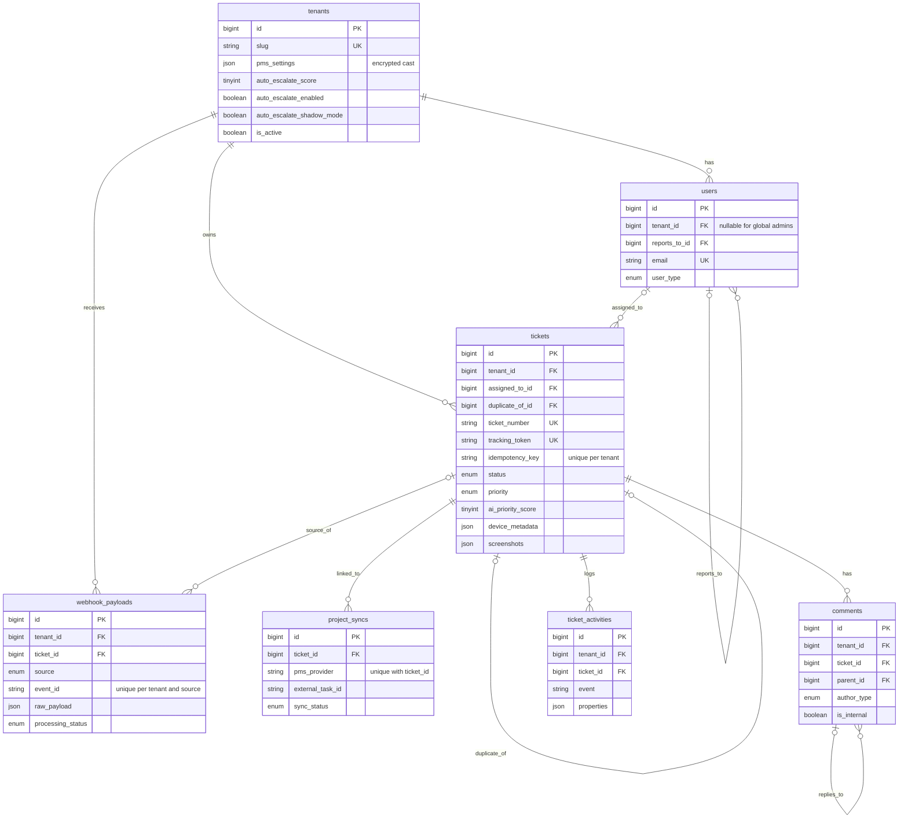

### Project Overview

A centralized, multi-tenant **Ticketing & Support Bridge** built with **Laravel** and **Filament** that connects live production applications directly to an external Project Management System (PMS). It streamlines bug reporting, client support communication, internal triage, and engineering task creation through a unified API and administrative hub.

---

### Core Objectives

* **Seamless Bug Capture:** Enable end-users inside production apps to click *"Report an Issue"*, automatically capturing the active URL, browser/device metadata, console errors, and viewport screenshots in a single API payload.
* **PMS Integration Bridge:** Convert verified tickets into actionable tasks inside the external PMS via API, maintaining bi-directional status synchronization so engineering progress automatically updates the ticket.
* **Client Support Loop:** Allow clients to track ticket statuses and exchange threaded comments both via REST API (embedded inside their app) and through a dedicated support interface, while keeping internal agent notes private.
* **Scalable Multi-Tenancy:** Built as a lean MVP with tenant isolation (`tenant_id`) from day one, allowing easy expansion from a single internal tool into a multi-client SaaS platform.

---

### Key System Capabilities

* **Filament Administration Panel:** Role-based access control (`Super Admin`, `Team Lead`, `Support Agent`) with hierarchical reporting (`reports_to`), manual ticket assignment, priority scoring, and one-click PMS escalation.
* **Sanctum-Secured API Gateway:** Asynchronous webhook ingestion (`POST /api/v1/tickets`) backed by Redis queues and raw payload logging (`webhook_payloads`) for auditability and safe retries.
* **Future-Ready AI Triage Engine:** Architecture designed to plug in an LLM evaluation agent that scores ticket severity, categorizes issues, and—once trusted—automatically pushes critical bugs directly to the PMS without human intervention.


## 1. Implementation Plan

This phased roadmap takes the platform from an MVP bridge to a multi-tenant, AI-triaged ticketing and support hub built on **Laravel** and **Filament**.

| Phase | Milestone | Key Deliverables |
| --- | --- | --- |
| **Phase 1: Core Infrastructure & MVP Bridge** | Foundation & API Ingestion | • Initialize Laravel project with Filament admin panel and Sanctum.<br>

<br>• Build database migrations for `tenants`, `users`, `tickets`, `webhook_payloads`, `project_syncs`, and `comments`.<br>

<br>• Create the `POST /api/v1/tickets` endpoint to capture bug payloads, URLs, device metadata, and screenshots.<br>

<br>• Configure Laravel Horizon / Redis queues for asynchronous payload processing. |
| **Phase 2: Filament Admin & Agent Hierarchy** | Triage & Role Management | • Implement Spatie Roles & Permissions (Super Admin, Team Lead, Support Agent).<br>

<br>• Build Filament Resources for Tickets, Tenants (Source Apps), and Agents.<br>

<br>• Add manual priority scoring, assignment workflows, and status transitions.<br>

<br>• Create the one-click or status-triggered **Push to PMS** Filament Action. |
| **Phase 3: PMS Bi-Directional Sync & Client Portal** | External Sync & Support Loop | • Build the outbound `SyncTicketToPmsJob` adapter to convert tickets into PMS tasks.<br>

<br>• Implement inbound PMS webhook listener to update ticket status upon task completion.<br>

<br>• Expose client-facing API endpoints (`GET /tickets/{id}`, `POST /tickets/{id}/comments`) and an optional Filament/Blade client support portal. |
| **Phase 4: Multi-Tenancy & AI Triage Engine** | Scale & Intelligent Automation | • Enforce global tenant scoping (`tenant_id`) across models and API tokens.<br>

<br>• Integrate an AI Triage Service (LLM queue job) to analyze bug descriptions, stack traces, and screenshots, assigning an `ai_priority_score` and category.<br>

<br>• Enable auto-escalation rules: tickets exceeding a confidence/severity threshold push directly to the PMS without human intervention. |

---

### Phase Exit Criteria

* **Phase 1:** `POST /api/v1/tickets` returns `202` within the latency target in Section 5. A repeated `Idempotency-Key` returns the original ticket. Revoking a tenant token takes effect immediately. Oversized payloads return `413`.
* **Phase 2:** An agent cannot read another tenant's tickets (tested). Every status or priority change writes a `ticket_activities` row. Double-clicking **Push to PMS** creates exactly one `project_syncs` row.
* **Phase 3:** A PMS webhook with a stale timestamp is rejected. A replayed `event_id` does not change state twice. Every PMS status used by the chosen provider is mapped. Failed syncs retry and appear in Filament.
* **Phase 4:** Duplicate detection is active. Shadow-mode agreement between AI and manual priority is reviewed (`AiAccuracyChart`) before auto-escalation is enabled for any tenant. The kill switch stops auto-push within one job cycle.

---

## 2. Business Flow

### End-to-End Lifecycle

1. **Capture (Production App):** A user encounters an issue and clicks **Report an Issue**. A lightweight JS/mobile widget captures the current URL, browser/OS metadata, console/network context, user notes, and a DOM/viewport screenshot, sending a `POST` request to the Bridge API.
2. **Ingestion & Queuing:** The Bridge API validates the app's Sanctum token and payload limits, honors the `Idempotency-Key` header (a repeat returns the original ticket), logs a scrubbed copy of the JSON in `webhook_payloads`, creates a `Ticket` record (`status: open`) with a tracking token, queues screenshot decoding, and returns an immediate `202 Accepted` response.
3. **Triage (Human or AI):**
* *MVP Mode:* An admin or team lead reviews the ticket in Filament, adjusts priority, assigns an agent, and decides if it requires engineering work.
* *AI Automated Mode:* An async AI agent evaluates severity and duplicates. High-severity bugs (`ai_priority_score >= tenants.auto_escalate_score`, default `85`) bypass manual review and trigger PMS task creation, but only when `auto_escalate_enabled` is on and `auto_escalate_shadow_mode` is off. In shadow mode the score is recorded and compared with manual decisions only.


4. **PMS Escalation:** A queued job maps the ticket fields (title, description, screenshot URL, environment metadata) to the external PMS API, creates a task, and saves the external `external_task_id` and `external_task_url` in `project_syncs`. Failed attempts retry with backoff. After the final attempt the ticket stays `triaged`, the sync is marked `failed`, and an agent is notified.
5. **Collaboration & Resolution:** Clients check ticket progress and post follow-up comments via the API or support portal. Internal agents can post either **public replies** (visible to clients) or **internal notes** (visible only to agents). When the PMS task closes, a webhook updates the ticket status to `resolved` and notifies the client.

```
[Production App] ──(POST /tickets)──► [API Gateway + Sanctum]
                                              │
                                    (Log Raw Webhook Payload)
                                              │
                                              ▼
                                      [Queue Worker]
                                     ┌────────┴────────┐
                                     ▼                 ▼
                            [AI Triage Agent]   [Filament Admin]
                            (Score & Classify)  (Assign & Review)
                                     │                 │
                                     └────────┬────────┘
                                              ▼
                                  (Severity Threshold / Manual Push)
                                              │
                                              ▼
                                     [PMS Sync Adapter] ◄──(Status Webhook)── [External PMS]
                                              │
                                              ▼
                                    [Client Portal / API]
                                  (Status & Public Comments)

```

---

### Ticket Status Lifecycle

| From | To | Triggered by | Notes |
| --- | --- | --- | --- |
| `open` | `triaged` | Agent / Team Lead, or AI score recorded | Priority and assignee set |
| `triaged` | `in_progress` | Agent | |
| `triaged`, `in_progress` | `pushed_to_pms` | `PushTicketToPmsJob` success | Only after a `project_syncs` row exists |
| `pushed_to_pms` | `in_progress` | PMS webhook (task started) | Mapped status |
| `pushed_to_pms`, `in_progress` | `resolved` | PMS webhook (task done) or agent | Triggers client notification |
| `resolved` | `open` | Client reopens within 14 days (proposed) | Re-enters triage |
| `resolved` | `closed` | Agent, or automatically after 14 days (proposed) | |
| Any open state | `closed` | Team Lead (spam or duplicate) | Requires an internal note |

Every transition writes a `ticket_activities` row. Invalid transitions are rejected with `422`.

#### PMS Status Mapping

| PMS status category | Ticket status | Client-visible comment |
| --- | --- | --- |
| Backlog / To do | `pushed_to_pms` | No |
| In progress | `in_progress` | No |
| Done / Completed | `resolved` | Yes: "Engineering marked task as Completed" |
| Cancelled / Won't fix | `closed` | Yes, with an agent note |

Unmapped PMS statuses are stored in `ticket_activities` and leave the ticket unchanged. Mappings are per provider and live in the connector class.

#### Outbound Sync Rules

* Priority and status changes are written to the PMS task as field updates.
* Public comments (`is_internal = false`) are posted to the PMS task. Internal notes are never sent.
* Outbound sync runs as a queued job, never inline in a Filament request.

---

## 3. Database Blueprint, Schema & ERD

### Entity Relationship Diagram (ERD)



### Table Schema Specifications

* **`tenants` (Source Apps / Client Organizations):** Enables multi-tenancy from day one.
* `id` (bigint, PK), `name` (string), `slug` (string, unique), `pms_project_id` (string, nullable), `pms_settings` (json, nullable, `encrypted` cast; holds PMS credentials and webhook secrets), `auto_escalate_score` (unsignedTinyInteger, default `85`; single source of truth for the threshold), `auto_escalate_enabled` (boolean, default `false`), `auto_escalate_shadow_mode` (boolean, default `true`), `is_active` (boolean, default `true`), `timestamps`.


* **`users` (Agents, Admins & Portal Users):** Supports hierarchical reporting (`reports_to_id`) and role-based access.
* `id` (bigint, PK), `tenant_id` (FK -> `tenants.id`, nullable for global admins), `reports_to_id` (FK -> `users.id`, nullable), `name` (string), `email` (string, unique), `password` (string, nullable; portal clients sign in with magic links), `user_type` (enum: `admin`, `agent`, `client`; staff roles come from Spatie, not this column), `timestamps`, `softDeletes`.


* **`tickets` (Core Issue & Support Records):**
* `id` (bigint, PK), `tenant_id` (FK -> `tenants.id`), `assigned_to_id` (FK -> `users.id`, nullable), `ticket_number` (string, unique, e.g., `TCK-10042`), `tracking_token` (string, 64 chars, unique; returned once at creation and stored hashed), `duplicate_of_id` (FK -> `tickets.id`, nullable), `pms_escalated_at` (timestamp, nullable), `reporter_name` (string, nullable), `reporter_email` (string, indexed), `title` (string), `description` (text), `page_url` (text, nullable), `device_metadata` (json — browser, OS, viewport, console errors; scrubbed before save), `screenshots` (json — array of storage paths/URLs), `status` (enum: `open`, `triaged`, `in_progress`, `pushed_to_pms`, `resolved`, `closed`), `priority` (enum: `low`, `medium`, `high`, `critical`), `ai_priority_score` (unsignedTinyInteger, nullable), `ai_analysis` (json, nullable), `idempotency_key` (string, nullable; unique per tenant), `timestamps`, `softDeletes`.


* **`webhook_payloads` (Audit & Replay Log):** Stores scrubbed incoming requests before parsing so failed payloads can be replayed from a Filament action.
* `id` (bigint, PK), `tenant_id` (FK -> `tenants.id`), `ticket_id` (FK -> `tickets.id`, nullable), `source_ip` (string), `source` (enum: `client_api`, `pms_webhook`), `event_id` (string, nullable; unique per tenant and source, used for idempotency), `headers` (json; allow-listed headers only), `raw_payload` (json; scrubbed), `processing_status` (enum: `pending`, `processed`, `failed`, `duplicate`), `attempts` (unsignedTinyInteger, default `0`), `error_message` (text, nullable), `timestamps`.


* **`project_syncs` (PMS Task Mapping):** Links each ticket to at most one external task per PMS provider (unique index on `ticket_id` + `pms_provider`), which prevents duplicate task creation.
* `id` (bigint, PK), `ticket_id` (FK -> `tickets.id`), `pms_provider` (string, e.g., `jira`, `clickup`, `linear`, `custom`), `external_task_id` (string, indexed), `external_task_url` (string), `sync_status` (enum: `synced`, `failed`, `out_of_sync`), `last_synced_at` (timestamp), `sync_attempts` (unsignedTinyInteger, default `0`), `last_error` (text, nullable), `timestamps`.


* **`comments` (Threaded Ticket Communication):** Holds internal agent notes and client-visible replies on a ticket.
* `id` (bigint, PK), `tenant_id` (FK -> `tenants.id`), `ticket_id` (FK -> `tickets.id`), `parent_id` (FK -> `comments.id`, nullable for threaded replies), `author_type` (enum: `agent`, `client`, `system`), `author_id` (bigint, nullable), `author_email` (string, nullable; display only, never used for authorization), `body` (text), `is_internal` (boolean, default `false` — hidden from client API/portal when `true`), `attachments` (json, nullable), `timestamps`.
* **`ticket_activities` (Audit Trail):** Records every status, priority, assignment, and PMS event. Feeds `AiAccuracyChart` (manual overrides vs. AI score).
* `id` (bigint, PK), `tenant_id` (FK -> `tenants.id`), `ticket_id` (FK -> `tickets.id`), `actor_type` (enum: `agent`, `client`, `system`, `pms`, `ai`), `actor_id` (bigint, nullable), `event` (string, e.g., `status_changed`, `priority_overridden`, `pushed_to_pms`, `pms_status_received`), `properties` (json, nullable), `created_at`.


---

## 4. Technical Documentation

### A. API Specification (Sanctum Authenticated)

All external requests must include `Authorization: Bearer <tenant_api_token>` and `Accept: application/json`. Submission requests must also include a unique `Idempotency-Key` header (UUID v4 recommended). Payloads are capped at 5 MB, with at most 5 screenshots of 2 MB each (PNG, JPEG, or WebP).

#### 1. Submit Bug / Support Ticket

* **Endpoint:** `POST /api/v1/tickets`
* **Request Payload:**

```json
{
  "title": "Checkout button unresponsive on Safari",
  "description": "Clicking Pay Now throws a TypeError in console.",
  "priority": "high",
  "page_url": "https://app.example.com/checkout?cart=992",
  "reporter": {
    "name": "Sara Ali",
    "email": "sara@client.com"
  },
  "device_metadata": {
    "browser": "Safari 18.1",
    "os": "macOS 15.1",
    "viewport": "1440x900",
    "console_errors": ["TypeError: undefined is not an object (evaluating 'cart.submit')"]
  },
  "screenshots": [
    "data:image/png;base64,iVBORw0KGgoAAAANSUhEUgAA..."
  ]
}

```

* **Request rules:**
  * `priority` is a hint only. The server sets the final priority during triage (default `medium`).
  * `title` max 255 characters. `description` max 10,000 characters. `reporter.email` must be a valid email.
  * `console_errors` max 50 entries, each truncated to 1,000 characters.
  * Repeating a request with the same `Idempotency-Key` returns `200 OK` with the original response and creates no second ticket. Keys are retained for 24 hours.
* **Response (`202 Accepted`):**

```json
{
  "status": "queued",
  "ticket_number": "TCK-10042",
  "tracking_url": "https://support.yourdomain.com/tickets/TCK-10042"
}

```

#### 2. Client Ticket Status & Comments

* **Get Ticket Details:** `GET /api/v1/tickets/{ticket_number}` requires the `X-Tracking-Token` header (returned once at creation). A missing or mismatched token returns `404`, not `403`, so ticket existence is not leaked.
* Returns ticket status, PMS sync state (sanitized), and all comments where `is_internal = false`.


* **Post Client Comment:** `POST /api/v1/tickets/{ticket_number}/comments`
* Requires `X-Tracking-Token`. The author is derived from the token. `author_email` is not accepted from the body.
* Body: `{"body": "Still happening after clearing cache.", "attachments": []}`


#### 3. Inbound PMS Status Webhook

* **Endpoint:** `POST /api/v1/webhooks/pms/{provider}`
* **Security:** HMAC-SHA256 over `timestamp + "." + raw body`, sent in the `X-PMS-Signature` header, with the timestamp in `X-PMS-Timestamp`. Requests older than 5 minutes are rejected. Each provider has its own secret, stored encrypted in `tenants.pms_settings`. The tenant is resolved from the matched `project_syncs` row, not from the URL.
* **Behavior:** Requires an `event_id`, which is stored in `webhook_payloads`. A duplicate `event_id` returns `200` without reprocessing. Matches `pms_provider` + `external_task_id` in `project_syncs`, maps the PMS status using the mapping table in Section 2, updates the parent `Ticket`, writes a `ticket_activities` row, and appends a `system` comment when the task is completed. Unknown tasks are logged and return `202`.

#### 4. Errors, Limits & Versioning

| Status | When |
| --- | --- |
| `200 OK` | Repeated `Idempotency-Key`; returns the original ticket |
| `202 Accepted` | Ticket or comment queued |
| `401 Unauthorized` | Missing, invalid, or revoked token |
| `404 Not Found` | Unknown ticket, or tracking token mismatch |
| `413 Payload Too Large` | Payload above 5 MB, or screenshot above 2 MB |
| `422 Unprocessable Entity` | Validation errors, with a field-level `errors` object |
| `429 Too Many Requests` | Rate limit hit; includes `Retry-After` |

* Errors use RFC 9457 Problem Details (`application/problem+json`).
* `/api/v1` is frozen once published. Breaking changes ship as `/api/v2`.

---

### B. Laravel & Filament Architecture Blueprint

#### 1. Service & Queue Pipeline

* **`IngestTicketAction`:** Runs inside a DB transaction. Checks the `Idempotency-Key`, stores a scrubbed copy of the payload in `webhook_payloads`, creates the `Ticket` with its tracking token, and dispatches `DecodeScreenshotsJob`, then `ProcessTicketPipelineJob`. `DecodeScreenshotsJob` validates the MIME type by content sniffing (not the data-URI prefix) and writes to a configurable disk (S3 in production, local in development). Decoding stays off the request path so the `202` response is fast.
* **`ProcessTicketPipelineJob`:**
1. Calls `AiTriageService::evaluate($ticket)` (when enabled) to populate `ai_priority_score` and `ai_analysis`.
2. Runs duplicate detection: same tenant, matching fingerprint (normalized title, `page_url` path, first console error) within 24 hours. Duplicates get `duplicate_of_id` set and are never auto-escalated.
3. Escalates only when `auto_escalate_enabled` is true and `ai_priority_score >= auto_escalate_score`. In shadow mode it writes the decision to `ticket_activities` only.
4. Dispatches `PushTicketToPmsJob` only if no `project_syncs` row exists for the ticket and provider.


* **`PmsConnectorInterface`:** Strategy pattern interface (`createTask(Ticket $ticket): PmsTaskDTO`, `fetchTaskStatus(ProjectSync $sync): PmsStatusDTO`, `parseWebhook(Request $request): PmsEventDTO`, `postComment(ProjectSync $sync, Comment $comment): void`) allowing clean swapping or multi-PMS routing without changing core controllers.
* **`PushTicketToPmsJob`:** Uses `$tries = 5` with a `$backoff` array (1 min, 5 min, 30 min, 2 h, 12 h). Each attempt updates `sync_attempts` and `last_error` on `project_syncs`. After the final failure the sync is marked `failed` and an agent is notified. Re-running the job for the same ticket and provider must not create a second task.

#### 2. Filament Admin Panel Design

* **Navigation & Resources:**
* `TicketResource`: Filterable tabs (`All`, `Unassigned`, `High AI Score`, `Pushed to PMS`, `Resolved`). Includes a custom **Push to PMS** header/row action and an **Activity & Comments Infolist** separating internal agent notes from client-visible replies. Status changes follow the lifecycle table above and write to `ticket_activities`.
* `TenantResource`: Manage connected production apps, generate/revoke Sanctum API tokens, configure per-app PMS project mappings and AI auto-escalation thresholds, and toggle auto-escalation and shadow mode (shadow mode is on by default; only Super Admins can enable auto-escalation).
* `UserResource`: Manage agent hierarchy (`reports_to_id`) and Spatie roles (`Super Admin`, `Team Lead`, `Support Agent`).


* **Widgets:**
* `TicketStatsOverview`: Open tickets, average triage time, and PMS escalation rate.
* `AiAccuracyChart`: Tracks manual priority overrides vs. AI-assigned priority scores to validate model readiness before enabling full auto-push.


#### 3. Security & Multi-Tenancy Controls

* **Global Scope (`BelongsToTenant` Trait):** Automatically appends `where('tenant_id', auth()->user()->tenant_id)` for non-super-admin users and API tokens, preventing cross-client data leaks. Queued jobs and console commands have no authenticated user, so jobs must carry `tenant_id` explicitly and set tenant context when they start. The scope must fail closed (throw) when no tenant context exists.
* **Rate Limiting:** Apply Laravel `RateLimiter::for('ticket-ingestion')` per tenant API token (e.g., 60 requests/minute) to protect the queue against client-side infinite error loops. Limit client endpoints per `X-Tracking-Token` (e.g., 30 requests/minute) and public routes per IP. Exceeding a limit returns `429` with `Retry-After`. Ingestion and comments use separate limiters.
* **PII & Secret Scrubbing:** A scrubber runs before persistence and removes, recursively and case-insensitively, keys matching `password`, `token`, `secret`, `authorization`, `cookie`, `credit_card`, `cvv`, and `api_key` from `device_metadata` and `raw_payload`. The same keys are removed from `page_url` query strings. `headers` are allow-listed, so `Authorization` and `Cookie` are never stored. Console errors are truncated and scanned for bearer tokens and emails.
* **Authentication Model:** Server-to-server apps use tenant Sanctum tokens (`HasApiTokens` on `Tenant`, so a token resolves directly to a tenant). Reporters and clients use the per-ticket `X-Tracking-Token`. Portal clients (`user_type = client`) sign in with magic links. Staff use Filament sessions with Spatie roles.
* **Webhook Security:** HMAC with a timestamp and replay window (see Section 4A). Per-provider secrets are stored with the `encrypted` cast.
* **Retention & Privacy:** Screenshots and raw payloads are purged after a retention period (proposed default: 90 days, configurable per tenant) by a scheduled command. Reporter emails are anonymized on erasure requests (GDPR Art. 17). Tickets use soft deletes, and hard deletion follows the retention period.
* **Storage Access:** Screenshots live on private disks and are served through signed, expiring URLs.

---

## 5. Non-Functional Requirements & Quality

| Area | Target (proposed) |
| --- | --- |
| Ingestion latency | p95 under 300 ms for the `202` response (screenshot decoding is async) |
| Queue latency | p95 job start under 60 s |
| Availability | 99.5% for the ingestion API (MVP) |
| Burst capacity | 50 tickets per minute per tenant without queue backlog over 5 minutes |
| Transport & at-rest encryption | TLS 1.2+ everywhere; encrypted database and storage disks |

* **Observability:** Structured JSON logs with `tenant_id`, `ticket_number`, and `request_id`. Metrics for ingestion count, job failure rate, PMS sync failure rate, and webhook rejections. Horizon dashboard enabled. Alert when the failed-job count or the PMS sync failure rate (above 5%) crosses a threshold.
* **Testing Strategy:**
  * Feature tests for every endpoint, including cross-tenant access returning `404`.
  * Idempotency tests for `Idempotency-Key` and PMS webhook `event_id`.
  * Webhook signature and replay-window tests.
  * Scrubber unit tests with secret and PII fixtures.
  * Job tests: double dispatch of `PushTicketToPmsJob` creates one PMS task.
  * PMS connector contract tests using recorded fixtures.
  * Filament tests for tenant isolation and status transitions.
  * Load test of the ingestion endpoint before Phase 1 sign-off.
* **Deployment:** Feature flags for auto-escalation and shadow mode. Every migration must have a tested rollback.

---

## 6. Open Decisions

These need confirmation before the related phase starts:

* **First PMS provider:** Jira, ClickUp, Linear, or custom.
* **Screenshot storage:** S3 or local disk in production.
* **Client portal authentication:** magic links (current proposal) or passwords.
* **Retention period:** 90 days proposed.
* **Auto-escalation threshold:** 85 proposed (the Business Flow previously said 80; now aligned to the `tenants` default).
* **Client comment sync:** whether public comments are posted to the PMS task.
* **Reopen and auto-close window:** 14 days proposed.
